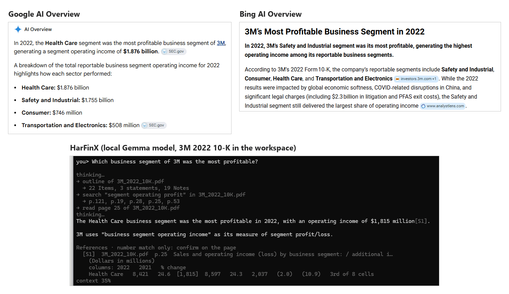

# HarFinX

**Har**ness for **Fin**ance e**X**perts: an open-source (MIT) AI agent harness for financial workflows, built for analysts working on their own computer. It runs on the Pi agent core (`pi-ai` + `pi-agent-core`), is model-agnostic, and is local-first.

> Early stage (v0.0.1). Expect rough edges. Check any figure against its cited source.

## What it does

- Terminal chat with a local model (through Ollama) about your financial files.
- Answers questions about filings and reports in PDF (10-K, 10-Q, earnings releases): it maps the filing's Items, statements and Notes, finds the right page, reads the page or just the lines around some words, and cites the file and page. Text-based PDFs only; Excel is not supported yet. A small workspace's file list goes with the first question (`FILE_LIST_FIRST=off` disables it).
- Optional statement lookup (`STATEMENT_TOOL=on`): fetches one of 15 common balance sheet, income statement or cash flow lines of a 10-K or 10-Q as printed, with units and columns, and checks the balance sheet balances. If unsure it says so and the model reads pages instead.
- Exact arithmetic: the model never does maths itself. A decimal calculator tool does it, on numbers copied from your file, with named definitions for common measures (margins, free cash flow, quick ratio, net debt, DSO, ROE and more).
- Traceable figures: after each answer it checks that every figure comes from your file, your question or the calculator, and shows where in the pages read each one appears.
- Safe by default: one fixed workspace folder, limits per question, no file access for cloud models, and a local audit log of every session.

## How it compares

Same question, three tools, 15 Nov 2026: *Which business segment of 3M was the most profitable in 2022?* The harness had the 3M 2022 10-K in its workspace.



| | Answer | Checked against the filing (10-K p.25) | Shows where it read it |
|---|---|---|---|
| Google AI Overview | Health Care, $1.876 billion | Segment right, figure wrong (printed: $1,815 million) | Links to a website |
| Bing AI Overview | Safety and Industrial | Wrong (it earned $1,199 million) | Links to websites, no figures |
| HarFinX (local model) | Health Care, $1,815 million | Right | File, page and the matching row |

One question is an illustration, not a benchmark.

## Requirements (Windows)

1. **Node.js 22** or newer.
2. **Ollama for Windows**: <https://ollama.com>
3. A model: `ollama pull gemma4:12b` (about 8 GB, the default; fits a 12 GB GPU). `qwen3:14b` also works, but on a 12 GB GPU use an 8k context with it.
4. The context window, set in **both** places, then restart Ollama: the user environment variable `OLLAMA_CONTEXT_LENGTH=16384` (use `8192` for `qwen3:14b`) and the "Context length" in the Ollama app's settings. The harness reads the same variable, and warns if Ollama is running a different size, because Ollama silently drops the oldest text when the window is too small.

## Quick start

```
npm install
copy .env.example .env
npm start
```

Put your files in `workspace/` (created on first run, git-ignored) and ask, for example: `Using income-statement.csv, what was the FY2024 operating margin?` or, with a filing in the folder, `What was the company's net working capital at the end of 2021?`

```
npm start                                       # chat
npm start -- "Explain EBITDA in two sentences"  # one-off answer, for scripts
npm test                                        # tests (no model needed)
npm run typecheck
```

Chat commands: `/model` lists or switches the model, `/context` shows how much of the earlier conversation the model is shown (and `/context strict|balanced|lenient|off` changes it), `/new` clears the conversation, `exit` quits. Ctrl+C stops a running answer.

In a long chat the model is shown a shortened view of the earlier conversation: old page text becomes a one-line note, and the oldest questions drop out with a line saying so. Your full conversation and the audit log are never shortened. The level follows the model's context window by default; see `CONTEXT_MEMORY` in `.env.example`.

## Choosing a model

Two models have short names: `gemma` (the default) and `qwen`; any installed Ollama tag also works by its full name. Pick one per run with `npm start -- --model qwen`, switch in chat with `/model`, or set `OLLAMA_MODEL` in `.env`. Models can answer differently, so check figures against the source whichever you use.

## How answers are checked

- **Figure check.** Before an answer is shown, every figure in it is checked: it must be printed on a page the model opened, come from the calculator, or be in your question. If one is not, the model is told once, in a fixed message, to calculate it, read the page or leave it out, and answers again. If a figure still cannot be traced, the sentence holding it is left out and one line says so (set `FIGURE_FALLBACK=warn` to show the answer with a yellow warning line instead). Traceable is not the same as right: check the row and column of each cited figure.
- **Citations.** A dim mark such as `[1]` appears beside each figure the harness can cite. A figure read from a page points to its row: file, page, heading, units, column heading and the matching row. A figure the calculator computed points to its formula with the printed numbers it used and the rows they came from. The numbered entries are listed under the answer, followed by one line saying figures are matched by value on the page, so confirm the row and column. A figure that cannot be cited gets no mark.
- **Finished answers only.** The answer appears once the model has finished it (a dim `writing…` line shows meanwhile). Notes the model wrote while still reading pages are kept in the audit log and not shown.
- **`context N%`.** The last line shows how full the conversation is; near the limit it suggests `/new`.

## Safety and privacy

- **One folder.** Only `WORKSPACE_DIR` (default `workspace/`) is readable, fixed at startup, and never chosen by the model.
- **Limits per question.** About 8 tool calls and 12,000 characters of file text. At a limit the model is told to answer from what it has already read (calculator calls may run a little further); if it asks for more anyway, the question is stopped. Each tool call shows as a dim one-line note; a yellow `[guard]` line means a limit acted.
- **Untrusted file contents.** Text inside a file is data, not instructions; the guards limit what the model can reach, not what it says.
- **Model quirks.** An empty or looping reply is discarded and retried once.
- **Audit log.** Every session writes `audit/session-<timestamp>-<id>.jsonl` (set by `AUDIT_DIR`): questions, answers (with reply times), tool calls and guard decisions. It is append-only and local, and contains your data, so treat it as such.
- **Local by default.** With Ollama everything stays on your machine and no identifying headers are sent.

## Using Claude (optional, paid)

Set `PROVIDER=anthropic` and `ANTHROPIC_API_KEY=<a Console API key>` in `.env`. A Claude Pro/Max subscription cannot be used: HarFinX accepts only a Console API key, and refuses to start if a subscription token is present. Prompts then go to Anthropic's API, and file access stays off unless you set `ALLOW_CLOUD_FILES=1`. Development and testing focus on local models.

## Evaluation

`eval/` holds a small harness for the public FinanceBench open sample. It downloads the dataset on demand (a public, non-commercial file that is not included here), runs questions through the real CLI, and writes result files for grading. Scores are not comparable to published FinanceBench numbers.

## Layout

`src/` is the harness (`tools/` the tools, `documents/` PDF reading and page search, `calc/` the calculator, `cli.ts` the chat loop, `engine.ts` the work around one question); `eval/` is the evaluation harness; `test/` holds the tests.

## License

MIT. See [LICENSE](LICENSE).
